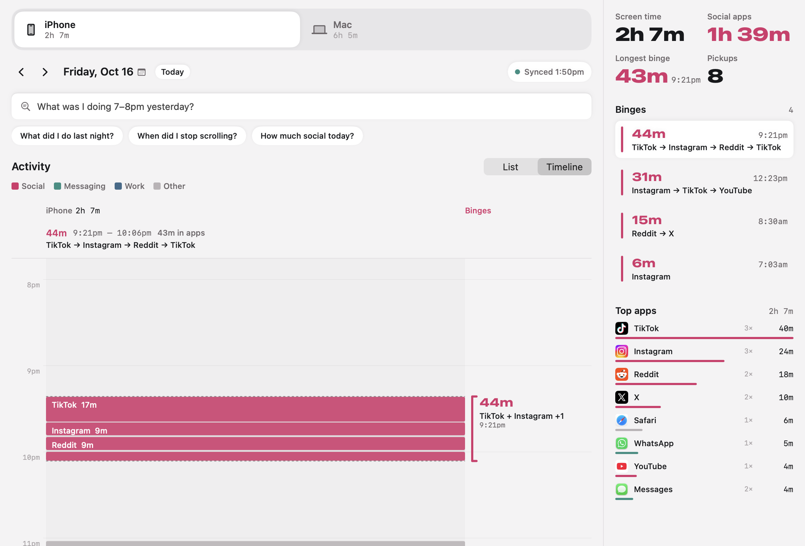
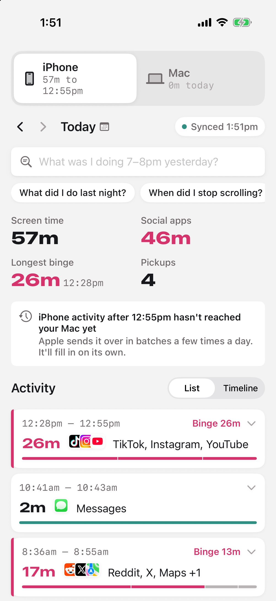
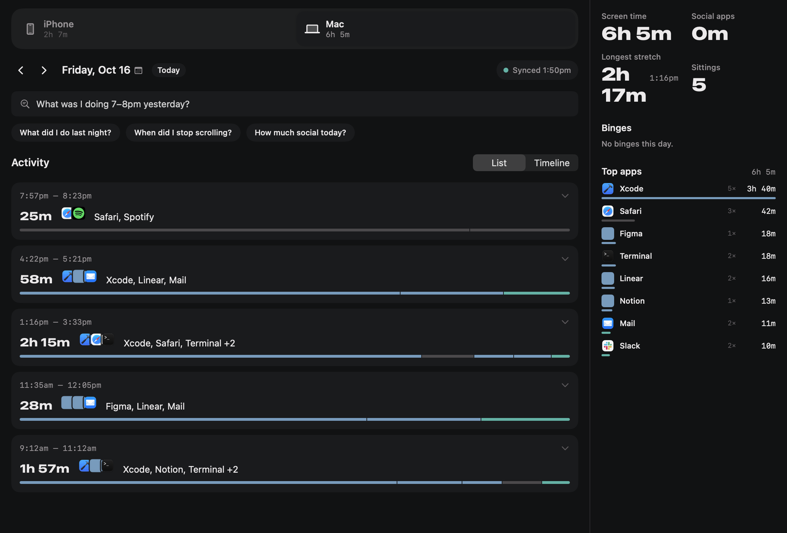

# Scrollback

See exactly what you did on your iPhone and Mac, minute by minute. Ask "what was I doing 7–8pm yesterday?" or "when did I stop scrolling?" and get a straight answer.



| iPhone | Mac, dark |
| --- | --- |
|  |  |

Every screenshot shows made-up demo data (see [Try it with demo data](#try-it-with-demo-data)), not anyone's real usage.

## Where the data comes from

macOS already records which app is in front, for this Mac and for any iPhone that syncs Screen Time ("Share Across Devices"). That record lives in Apple's Biome store:

```
~/Library/Biome/streams/restricted/ScreenTime.AppUsage/local/  this Mac (idle time already removed)
~/Library/Biome/streams/restricted/App.InFocus/remote/<uuid>/  your iPhone
~/Library/Biome/sync/sync.db                                   which uuid is which device
```

Each file is a SEGB v2 segment of protobuf records: app bundle ID, start or end, timestamp, and how the app was opened (Home Screen, App Switcher, notification…). `Packages/ScrollbackCore` decodes these, pairs them into sessions, and copies them into its own SQLite store. Apple deletes Biome records after about three weeks, but Scrollback's copy keeps them indefinitely.

On the iPhone, Screen Time's DeviceActivity APIs add a live view of today. [docs/SCREEN-TIME.md](docs/SCREEN-TIME.md) explains what each source can and can't see.

A **binge** is a run of social apps where each hop happens within 2 minutes and the whole run lasts at least 5 minutes, with at least 3 minutes of it spent in the apps.

## Pieces

| Part | What it does |
| --- | --- |
| `Packages/ScrollbackCore` | SEGB decoder, sessionizer, binge detection, SQLite store, Ask (Apple's on-device model with tool calls), encrypted LAN sync, iCloud sync |
| `Apps/Mac` | Menu bar glance and full window. Reads Biome every 5 minutes and serves sessions to the iPhone |
| `Apps/iOS` | Same timeline and Ask. Pulls sessions from the Mac over your Wi-Fi, and from your private iCloud anywhere |
| `Extensions/` | iPhone Screen Time report, doomscroll monitor (with a nudge after 20 nonstop minutes) and widgets |
| `scrollback` CLI | `swift run scrollback yesterday 19:00-20:00` or `swift run scrollback ask "when did I stop scrolling"`, run in `Packages/ScrollbackCore` |

## What you need

- A Mac on macOS 26 with Xcode 26, and [XcodeGen](https://github.com/yonaskolb/XcodeGen) (`brew install xcodegen`). The Xcode project is generated from `project.yml` and isn't checked in.
- To try the apps with demo data: nothing else.
- To run them on your own data: a paid Apple Developer Program membership. The iPhone app needs the Family Controls (Screen Time) capability and both apps use iCloud, and Apple only grants those to paid teams.
- For Ask: Apple Intelligence turned on, on whichever device you use it.

## Try it with demo data

Demo mode fills the app with a made-up week from `DemoData.swift`. It uses a throwaway database and never reads your Biome history or syncs anything. It builds unsigned, so no Apple account is needed:

```sh
xcodegen generate
xcodebuild -project Scrollback.xcodeproj -scheme ScrollbackMac -configuration Debug \
  -derivedDataPath .build/try CODE_SIGNING_ALLOWED=NO build
.build/try/Build/Products/Debug/Scrollback.app/Contents/MacOS/Scrollback -demo YES
```

The iPhone app takes the same `-demo YES` launch argument and skips Screen Time setup in the simulator. `scripts/screenshots.sh` regenerates the images above from demo data, and shows how to build both apps unsigned and run the iPhone one in a simulator.

## Run it on your own data

1. Copy `Config/Secrets.example.xcconfig` to `Config/Secrets.xcconfig` (it's gitignored) and fill in your Team ID and a bundle ID prefix you control. Every bundle ID, the iCloud container (`iCloud.<prefix>.scrollback`) and the App Group (`group.<prefix>.scrollback`) come from those two values, and the scripts read them too.
2. `scripts/install-mac.sh` builds the Mac app, signs it with your Developer ID, has Apple notarize it, and installs it into `/Applications`. Add `--skip-notarize` for a quicker build.
3. In System Settings → Privacy & Security → Full Disk Access, turn on Scrollback. Then press **Check again** in the app.
4. Plug in your iPhone and run `scripts/install-phone.sh`. The first time, trust the developer on the phone in Settings → General → VPN & Device Management, and allow local network access when asked. Then grant Screen Time access in the app and pick your doomscroll apps.
5. Optional: `scripts/phone-autoinstall.sh` installs a launch agent that reinstalls the phone app whenever it's plugged in and the code has changed since the last install, or the build is close to its one-year expiry.

### iCloud history (once per container)

1. In the developer portal, make sure your iCloud container `iCloud.<prefix>.scrollback` exists and both app IDs (`<prefix>.scrollback` and `<prefix>.scrollback.macos`) have iCloud with CloudKit and that container. Automatic signing usually does this on the next build with `-allowProvisioningUpdates`.
2. `xcrun cktool save-token --type management`, then `scripts/cloudkit-schema.sh`.
3. In CloudKit Console, deploy the schema to Production. Every build, USB or TestFlight, uses Production so the Mac and phone see the same database. Production never adds fields on its own, so redo steps 2 and 3 whenever `CloudKit/schema.ckdb` changes, before installing the build that needs it.

iCloud makes the Mac app carry a Developer ID provisioning profile; `scripts/install-mac.sh` fetches it during export. If that profile ever expires, re-run the script or the app won't open.

## Tests

```sh
cd Packages/ScrollbackCore && swift test
```

The tests build their Biome files from scratch with `SEGBBuilder`, so they need no real data or Full Disk Access. `scripts/test-phone.sh` runs the UI tests on a plugged-in, unlocked iPhone and saves their screenshots to `assets/generated/ui-test/`, which is gitignored because they show that phone's real usage.

## Sync security

The Mac and iPhone share a 32-byte key (`~/Library/Application Support/Scrollback/peer.key`, mode 0600), baked into the phone build at install time. Requests are HMAC-signed with a timestamp and can't be replayed. Responses are ChaChaPoly-encrypted and bound to the request. The server accepts four connections at a time and gives no response to unauthenticated requests.

`scripts/testflight.sh` bakes the same key into the TestFlight build, so anyone you invite to that build can read your Mac's history on your Wi-Fi. Only invite yourself.

## iCloud history

The Mac also saves its history to your own private iCloud database, one record per UTC day, re-sent only when that day changes. The phone fetches changed days whenever it opens, before trying the Mac on Wi-Fi, so history keeps arriving away from home. Each record's payload is in CloudKit's encrypted values, which are end-to-end encrypted with keys in your iCloud Keychain, so neither Apple nor Scrollback can read it. Only the Mac writes; the phone only reads. Nothing from the Screen Time extensions (live doomscroll milestones, the Today report) is ever written to iCloud; it stays on the phone.

## Known limits

- iPhone data appears once Apple syncs it to the Mac, usually within minutes but sometimes hours.
- One Mac per Apple ID. A second Mac writing the same iCloud days would overwrite the first's.
- An iPhone session that reaches the Mac (via Apple's sync) after a day was saved to iCloud, but that the phone already had over Wi-Fi, can disappear from the phone until the Mac saves that day again on its next refresh.
- If the phone's iCloud change token expires, the full re-fetch can't see days the Mac deleted outright in the meantime, so those stay on the phone.
- Away from home, the phone gets history as of the Mac's last iCloud save (every 5 minutes while the Mac is awake). Without iCloud it shows its last synced copy.

## License

[MIT](LICENSE)
